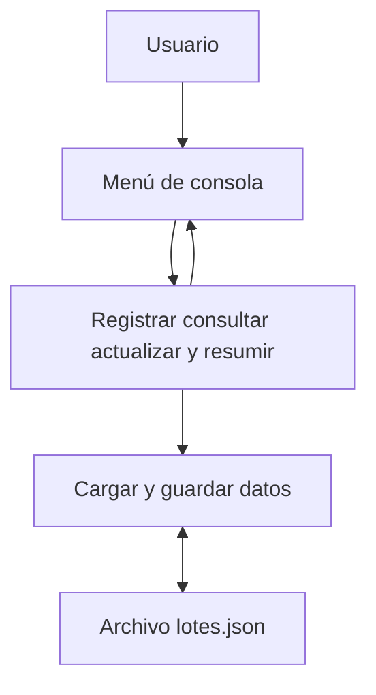

# Arquitectura del sistema

El programa funciona en una computadora y organiza sus funciones dentro de main.py.

El usuario selecciona una opción del menú. Las funciones procesan los datos y muestran el resultado. El archivo lotes.json conserva los lotes al cerrar el programa.
